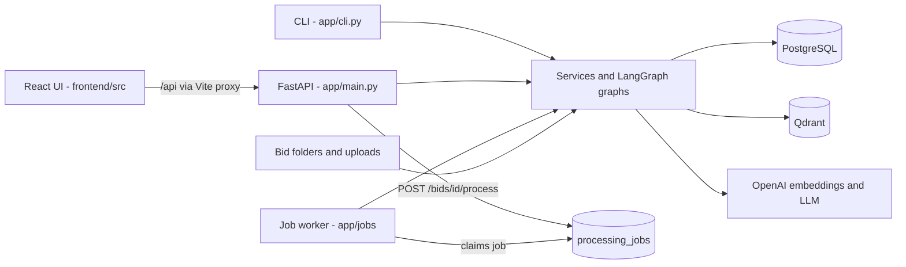
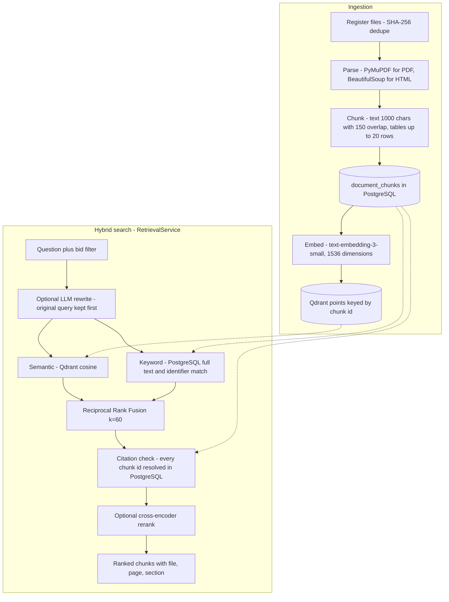
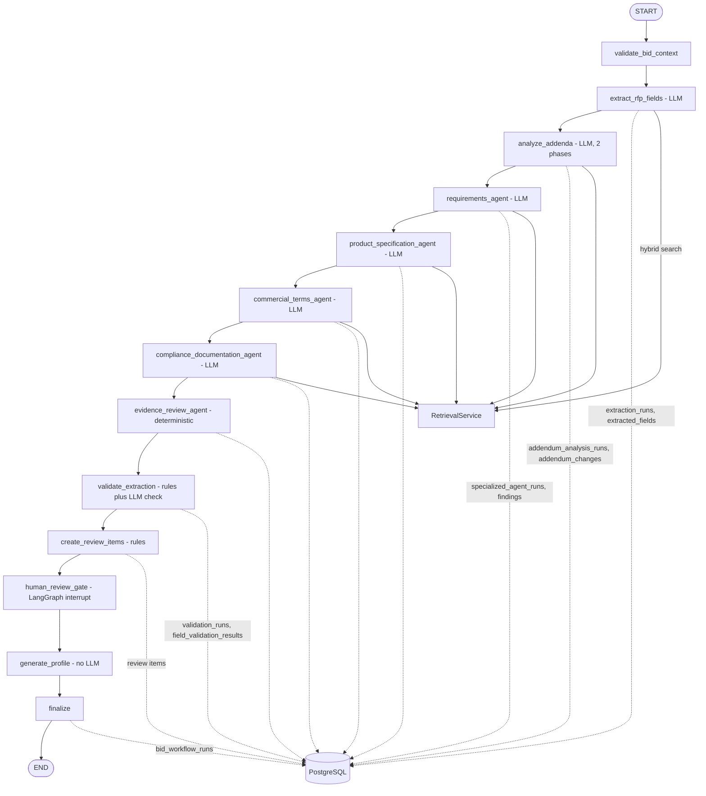
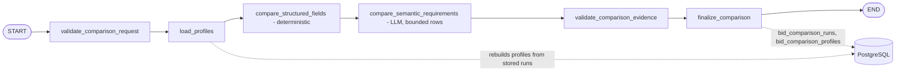
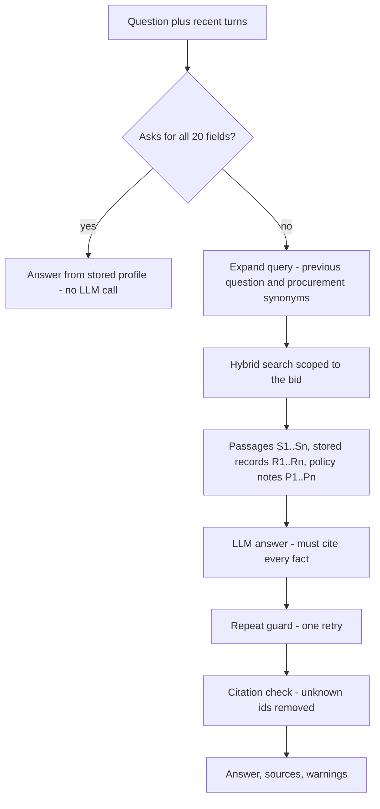

# Architecture

The diagrams below are drawn from the code. Each section names the files it describes.

## 1. System overview

The React UI and the CLI call the same backend services. PostgreSQL is the source of truth for documents, chunks, every run and its findings, review items and job history. Qdrant holds only the chunk embeddings and the payload needed to filter and cite them. OpenAI provides embeddings and the chat model.

- The worker runs inside the API process by default (`JOB_WORKER_EMBEDDED=true`); `python -m app.worker` runs it on its own.
- Jobs are claimed with `SELECT … FOR UPDATE SKIP LOCKED`, and each job sends heartbeats while it runs.

## 2. Ingestion and the search engine

Code: `app/ingestion/` (registry, parsers, chunking, indexing, `end_to_end_pipeline.py`) and `app/retrieval/` (`semantic_search.py`, `keyword_search.py`, `fusion.py`, `query_rewriter.py`, `reranker.py`, `retrieval_service.py`, `citations.py`).

- If one search backend fails and `SEARCH_ALLOW_DEGRADED=true`, the search returns `semantic_only` or `keyword_only` results with a warning.
- Extraction turns query rewriting and reranking off. The chat uses the settings in `.env`.

## 3. Agents and how they communicate

Code: `app/agents/workflow.py` (graph), `app/agents/state.py` (state), `app/agents/specialized.py` (agent definitions), `app/observability/instrumentation.py` (node events).

The agents do not call each other or exchange chat messages. They communicate through two channels:

1. **The LangGraph state** (`BidIntelligenceState`), which carries only ids, stage statuses, short summaries, warnings and errors. It never carries document text or prompts.
2. **PostgreSQL run records.** Each node writes its own run and findings, then puts the run id into the state. A later node loads what it needs by that id. For example, validation reads the extraction run and the latest addendum run, and the profile is built from the extraction, validation and addendum run ids.

- **Failure routing:** every node except `finalize` has a conditional edge (`route_after_stage`) to `finalize`. A failed stage therefore ends the run with a failed status and can never produce a profile reported as successful. These failure edges are left out of the diagram for readability.
- **Node events:** every node is wrapped by `instrument_node`, which writes a `workflow_node_events` row with the node name, timing, status, error category and the run ids at that point. The agent trace in `agent_trace/` is rebuilt from these rows and the run tables.
- **Human review:** `create_review_items` applies deterministic rules, such as low confidence, invalid citations or unresolved conflicts, to open review items. When `HUMAN_REVIEW_ENABLED=true`, `human_review_gate` pauses the graph with `interrupt()`, and the reviewer's decisions resume it with `Command(resume=…)`. With review disabled, as in the local `.env`, the gate is skipped and the profile is marked `needs_review`.
- **Checkpoints:** the graph uses `InMemorySaver`. Checkpoints are lost on restart, and PostgreSQL keeps the durable history.

### Bid comparison graph

Code: `app/agents/bid_comparison_agent.py`.

Comparison never re-runs extraction. It rebuilds each bid's profile from the stored runs and records which run ids it used.

## 4. Bid chat (question answering)

Code: `app/services/bid_qa_service.py` and `app/services/bid_qa_context.py`. The chat is read-only.

When comparison bids are given, each bid is searched on its own, and every passage and record is labelled with its bid.

## Where the prompts are

Every prompt that receives document text starts with `UNTRUSTED_DOCUMENT_POLICY` from `app/core/prompt_security.py`, which tells the model to treat document text as data and not as instructions. The query rewriter sees only the user's question, so it has its own short system prompt without that policy.

| Stage | Prompt |
|---|---|
| Field extraction | `app/services/extraction_service.py` `SYSTEM_PROMPT` |
| Addendum analysis | `app/services/addendum_analysis_service.py` `DISCOVERY_SYSTEM_PROMPT`, `COMPARISON_SYSTEM_PROMPT` |
| Specialized agents | `app/agents/specialized.py` `AGENT_DEFINITIONS` |
| Validation (semantic check) | `app/services/extraction_validation_service.py` `SEMANTIC_SYSTEM_PROMPT` |
| Query rewriting | `app/retrieval/query_rewriter.py` `QueryRewriter.rewrite` |
| Comparison | `app/agents/bid_comparison_agent.py` (semantic comparison node) |
| Chat | `app/services/bid_qa_service.py` `SYSTEM_PROMPT` |
